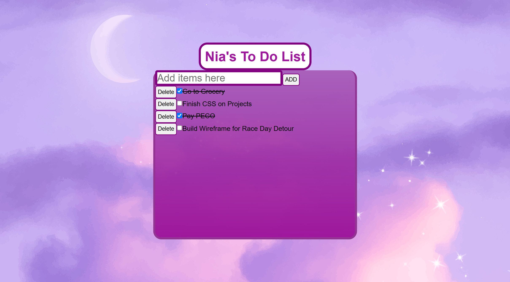

# ✅ Simple TO DO LIST

## Project Description

A very simple To Do List web app. Inputs for items to complete. Each item can be checked off as complete or completely deleted. 

## Tech Stack

- **HTML** 
- **CSS**
- **JavaScript**

## How to Run or View It

1. Clone or download the repository.
2. Open `index.html` in a browser or serve the project using a local development server.
3. Input item "To Do"
4. Click **ADD**
5. Item will then displays and has the option to be checked off as completed or completely deleted.

## Screenshots and Demo

### Application Interface

The interface displays an input to add items to complete, each item then displays and has the option to be checked off as completed or completely deleted.